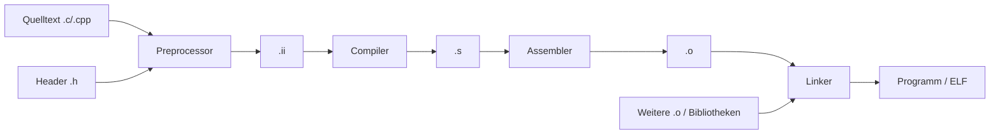
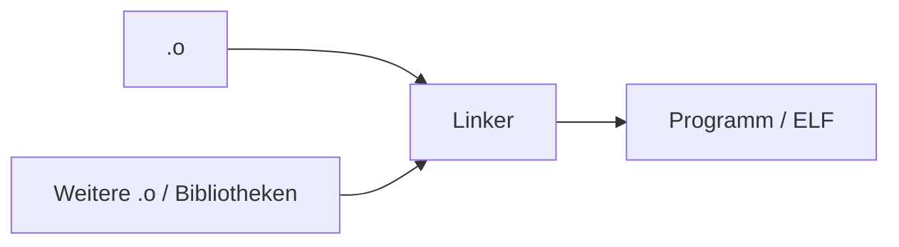
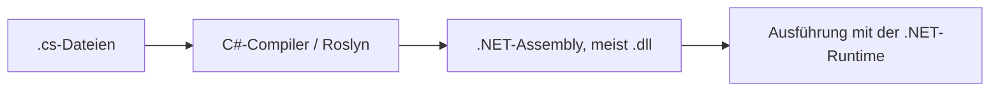
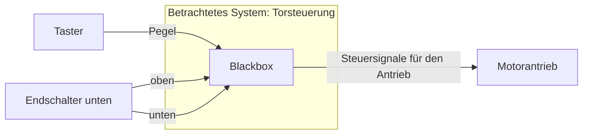
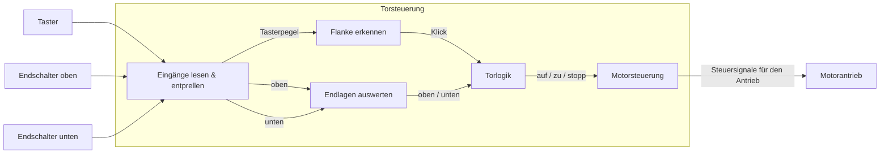

# IoT Workshop

## MB02 · C/C++ Build und Systemdesign

_Fredy Hirt · 17.11.2026_

**Today:** Embedded Systems · C/C++ Build-Pipeline · Top-Down

---

## Previously on...

<div style="font-size: 22px">

- Ihr habt eine Übersicht über das Modul und die Werkzeuge, die wir benutzen
- Ihr kennt den Umfang und Modus des Leistungsnachweises und habt euch in Gruppen organisiert
- Ihr wisst, was im Umgang mit Hardware zu beachten ist
- Ihr seid in der Lage, ein Programm auf eurer Hardware auszuführen
- ~~Ihr kennt den Begriff _Internet of Things_, dessen Herkunft und könnt erläutern, was heute darunter verstanden wird~~

</div>

---

# Today

- Nachtrag: Geschichte des IoT (45 min)
- Embedded Systems (5 min)
- C/C++ Build-Pipleine (20 min)
- Top-Down Systementwurf (20 min)
- C Auftrag & Arbeit am Projekt (90 min)

---

# Ziele

<div style="font-size: 22px">

- Ihr könnt die gundlegenden Eigenschaften von _Embedded Systems_ benennen.
- Ihr kennt den Ablauf der C/C++ Build-Pipeline
- Ihr unterscheidet Build-, Upload- und Laufzeitfehler.
- Ihr identifiziert Subsysteme nach dem Top-Down-Prinzip.

</div>

---

## Embedded Systems

<div style="font-size: 22px">

- Spezialisiertes System aus **Hardware und Software** für eine bestimmte Aufgabe, häufig in ein technisches Gesamtsystem integriert [1].
- Je nach Anwendung **Echtzeitanforderungen**: Das Ergebnis muss innerhalb einer vorgegebenen Frist vorliegen [1].
- **Begrenzte Ressourcen**: Rechenleistung, Speicher und Energiebudget.
- **Erhöhte Anforderungen** an Zuverlässigkeit, Betriebssicherheit und Robustheit [1].
- Im Jahr 2009 wurden rund 98 % der neu poduzierten Prozessoren in Embedded Systems verbaut. [2].

</div>

<div class="source">[1] M. Barr, <a href="https://barrgroup.com/introduction-0">«Introduction», <em>Programming Embedded Systems in C and C++</em></a>, Abschnitte «What is an Embedded System?», «Real-Time Systems» und «Variations on the Theme», Barr Group.</div>

<div class="source">[2] M. Barr, <a href="https://barrgroup.com/embedded-systems/glossary">«Embedded Systems Glossary»</a>, Abschnitt «Introduction», Barr Group.</div>

---

# Vom Source-Code zur Firmware

## C/C++ Build-Pipeline

---

# Wer macht was?

| Aufgabe | Bekannt aus C# / .NET | In C/C++ |
| --- | --- | --- |
| Code bearbeiten | Visual Studio / VS Code | VS Code |
| Build koordinieren | `dotnet build` / MSBuild | PlatformIO: `pio run` [3] |
| Quelltext übersetzen | C#-Compiler (Roslyn) | C-/C++ Toolchain |
| Ziel konfigurieren | `.csproj`, z. B. Target Framework | `platformio.ini`, z. B. Board |
| Programm bereitstellen | z. B. `dotnet publish`, danach verteilen | Firmware builden und ins Flash laden |

**Der Compiler läuft auf eurem Rechner, die Firmware auf dem ESP32.**

---

# The C/C++ Build Pipeline



Zwischenergebnisse müssen nicht als Dateien gespeichert werden [4].

<div class="source">[4] Free Software Foundation, «Options controlling the kind of output», <em>Using the GNU Compiler Collection (GCC)</em>.</div>

<!-- Vereinfachtes Modell ohne Link-Time-Optimierung. .o enthält Objektcode; .s ist lesbarer Assemblertext. -->

---

# Preprocessor

Quelltext + Header → Preprocessor → `.ii`

<div class="two-columns">
<div>

```cpp
#include <QwiicLedStick.h>
#define BLINK_DELAY_MS 500

static LED leds;
void loop() {
    leds.setLEDColor(255, 0, 0);
    delay(BLINK_DELAY_MS);
    leds.LEDOff();
    delay(BLINK_DELAY_MS);
}
```

</div>
<div style="font-size: 25px; letter-spacing: 0">

- `#include` fügt den Inhalt des Headers ein.
- `#define` ersetzt hier `BLINK_DELAY_MS` durch `500`.

</div>
</div>

<!-- Auszug aus blinky-esp32/src/main.cpp; setup() initialisiert Serial, Wire und den LED Stick. QwiicLedStick.h liegt in lib/led/; PlatformIO ergänzt den Include-Suchpfad. Im präprozessierten main.cpp.ii die Klasse LED und delay(500) suchen. Makroersetzung arbeitet auf Tokens. #if ist kein if zur Laufzeit. -->

---

# Header und Implementierung

<div class="two-columns">
<div>

**C/C++: Header/Source-Paar**

```cpp
// QwiicLedStick.h (Auszug)
class LED {
public:
    LED();
private:
    uint8_t _LEDAddress;
};

// QwiicLedStick.cpp: Definition
#include "QwiicLedStick.h"
LED::LED() {
    _LEDAddress = 0;
}
```

</div>
<div>

**C#: eine Datei**

```csharp
public class LED
{
    private byte ledAddress;

    public LED()
    {
        ledAddress = 0;
    }
}
```

</div>
</div>

---

# Compiler und Assembler


- **Compiler:** prüft Syntax und Typen, optimiert und übersetzt C/C++ in Assemblercode.
- **Assembler:** übersetzt Assemblercode in eine Objektdatei (`.o`) in Maschinencode.
- Jede `.c/.cpp`-Datei samt Headern bildet eine **Übersetzungseinheit**.
- Externe Funktionsaufrufe können in der Objektdatei noch unaufgelöst sein.

**Objektcode ist noch keine fertige Firmware.**

---

# Linker



- Verbindet Objektdateien und benötigten Bibliothekscode.
- Löst Verweise auf Funktionen und globale Daten auf.
- Ordnet Code und Daten Speicherbereichen zu.

---

# So kennt ihr es aus C# / .NET

**Quellcode → Build → Programm starten [5]**



- **Beim Build:** Der Compiler prüft den C#-Code und erzeugt eine .NET-Assembly, meist eine `.dll`.
- **Beim Starten:** Die .NET-Runtime lädt das Programm und übernimmt dessen Ausführung auf dem Rechner.

<div class="source">Weiterführendes: [5] Microsoft, <a href="https://learn.microsoft.com/en-us/dotnet/standard/managed-execution-process">«Managed execution process» – JIT (Just-in-Time): Übersetzung in Maschinencode während der Ausführung</a>. [6] Microsoft, <a href="https://learn.microsoft.com/en-us/dotnet/core/deploying/native-aot/">«Native AOT deployment overview» – AOT (Ahead-of-Time): Übersetzung in Maschinencode vor der Ausführung</a>.</div>

---

# Vom Rechner auf den ESP32

**Cross-Compilation:** Auf dem Host builden, für das Target übersetzen.

<div class="two-columns">
<div>

**`platformio.ini` · Auszug aus Blinky**

```ini
[env:esp32dev]
platform = espressif32
board = esp32dev
framework = arduino
```

Zielplattform, Board und Framework bestimmen die Build-Umgebung.

</div>
<div>

**Ein PC-Programm lässt sich nicht einfach auf den ESP32 kopieren.**

</div>
</div>

---

# Fehler der richtigen Phase zuordnen

| Fehlermeldung | Phase | Prüfung |
| --- | --- | --- |
| `No such file ...` | Präprozessor | Headername, Suchpfad |
| `expected ... ';' ...` | Compiler | Erste Fehlermeldung und Code davor |
| `undefined reference` | Linker | Definition vorhanden und mitgelinkt? |
| `multiple definition` | Linker | Definition mehrfach vorhanden? |
| Keine Verbindung zum Board | Upload | Port, Kabel, Boot-Modus |

---

# Top-down-Systemdesign

## Vom Ganzen ins Detail

---

# Ausgangslage

- Komplexe Systeme
- Viele Eingänge und Ausgänge
- Viele Abhängigkeiten
- Nicht direkt vollständig lösbar

---

# Ziel

- Komplexität reduzieren
- Struktur sichtbar machen
- Verantwortlichkeiten trennen

---

# Vom Ganzen ins Detail

**Anforderungen → Systemteile → Schnittstellen → Umsetzung**

- Systemgrenze und beobachtbares Verhalten beschreiben.
- Aufgaben schrittweise in überschaubare Teile zerlegen.
- Ergebnisse mit Szenarien prüfen und den Entwurf verfeinern.

**Top-down gibt die Denkrichtung vor. Rückkopplung gehört dazu.**

<!-- Kein vollständiger Detailentwurf vor dem ersten Experiment nötig. Ein Prototyp darf Annahmen widerlegen und den Entwurf verändern. -->

---

# Beispiel · Ein Garagentor steuern

<div style="font-size: 22px; letter-spacing: 0; text-align: left">

«Ich möchte mein Garagentor mit einer einzigen Taste bedienen. Wenn es geschlossen ist, soll es auf Knopfdruck aufgehen. Ist es offen, soll dieselbe Taste es wieder schliessen. Während es fährt, möchte ich es mit einem weiteren Druck anhalten können. Drücke ich danach nochmals, soll es in die andere Richtung fahren. Ganz oben und ganz unten gibt es jeweils einen Endschalter. Dort soll das Tor automatisch anhalten.»

</div>

---

# Aus Wünschen werden Anforderungen

| ID | Prüfbare Anforderung |
| --- | --- |
| A1 | Nach dem Start ist die Position unbekannt. Der erste Tastendruck startet das Schliessen. |
| A2 | Ein Tastendruck bei geschlossenem Tor startet das Öffnen, bei offenem Tor das Schliessen. |
| A3 | Ein Tastendruck während der Fahrt stoppt den Motor. |
| A4 | Ein Tastendruck nach einem Stopp startet die Gegenrichtung zur letzten Fahrt. |
| A5 | Der jeweilige Endschalter erkennt die Endlage und beendet die Fahrt. |

---

# Systemgrenze · Erst die Blackbox



**Was kommt hinein, was geht hinaus, wer ist ausserhalb?**

<div class="source">Taster, Endschalter und Motorantrieb liegen ausserhalb der betrachteten Steuerung.</div>

---

# Whitebox · Die Steuerung im Detail



**Aus elektrischen Pegeln werden Ereignisse und schliesslich Motorbefehle.**

---

# Whitebox · Wer weiss was?

| Baustein | Verantwortung | Übergabe |
| --- | --- | --- |
| GPIO-Eingänge | Taster, Endschalter oben und unten einlesen und entprellen | Drei getrennte stabile Pegel |
| Flankenerkennung | Übergang von `Low` nach `High` erkennen | Ein Klickereignis |
| Endlagenauswertung | Gültigkeit und Entscheidung bei Störung | offen / geschlossen |
| Torlogik | Eingänge, Zustand und letzte Richtung auswerten | auf / zu / stopp |
| Motorsteuerung | AUF und ZU gegenseitig verriegeln, GPIOs setzen | Steuersignale für den Antrieb |

---

# Schnittstellen

Beschreiben:
- Was wird kommuniziert?
- In welcher Form?
- In welcher Richtung?

---

# Den Entwurf mit Szenarien prüfen

**Testfälle aus unseren Beispielanforderungen ableiten**

| Eingang / Situation | Erwartung | Bezug |
| --- | --- | --- |
| Startposition unbekannt, dann Klick | Motor fährt zu | A1 |
| Geschlossen, Klick, Endlage oben erreicht | Motor fährt auf, dann Stopp | A2 / A5 |
| Offen, Klick, Endlage unten erreicht | Motor fährt zu, dann Stopp | A2 / A5 |
| Klick während des Öffnens, später erneut Klick | Stopp, danach schliessen | A3 / A4 |
| Klick während des Schliessens, später erneut Klick | Stopp, danach öffnen | A3 / A4 |

---

# Arbeit am Projekt

## IoT Workshop

---

# Arbeit am Projekt un Übungen

- Euer System als gemäss [Ausgangslage](https://github.com/HF-IT-A-B-24H-28H/.github-private/blob/main/ausgangslage.md) als Blackbox betrachten.
- [Auftrag LED-Board Simulator in C#](https://github.com/HF-IT-A-B-24H-28H/led-board-simulator)
- [Auftrag LED-Board ESP32 in C/C++](https://github.com/HF-IT-A-B-24H-28H/led-board-esp32)
---

<h1 class="compact-title">Quellen</h1>

<div class="source references-columns">

[1] M. Barr. “Introduction.” Barr Group. Accessed: Nov. 17, 2026. [Online]. Available: https://barrgroup.com/introduction-0

[2] M. Barr. “Embedded systems glossary.” Barr Group, sec. “Introduction.” Accessed: Nov. 17, 2026. [Online]. Available: https://barrgroup.com/embedded-systems/glossary

[3] PlatformIO. “pio run.” PlatformIO Documentation. Accessed: Nov. 17, 2026. [Online]. Available: https://docs.platformio.org/en/latest/core/userguide/cmd_run.html

[4] Free Software Foundation. “Options controlling the kind of output.” *Using the GNU Compiler Collection (GCC)*, sec. 3.2. Accessed: Nov. 17, 2026. [Online]. Available: https://gcc.gnu.org/onlinedocs/gcc/Overall-Options.html

[5] Microsoft. “Managed execution process.” Microsoft Learn. Accessed: Nov. 17, 2026. [Online]. Available: https://learn.microsoft.com/en-us/dotnet/standard/managed-execution-process

[6] Microsoft. “Native AOT deployment overview.” Microsoft Learn. Accessed: Nov. 17, 2026. [Online]. Available: https://learn.microsoft.com/en-us/dotnet/core/deploying/native-aot/

</div>
